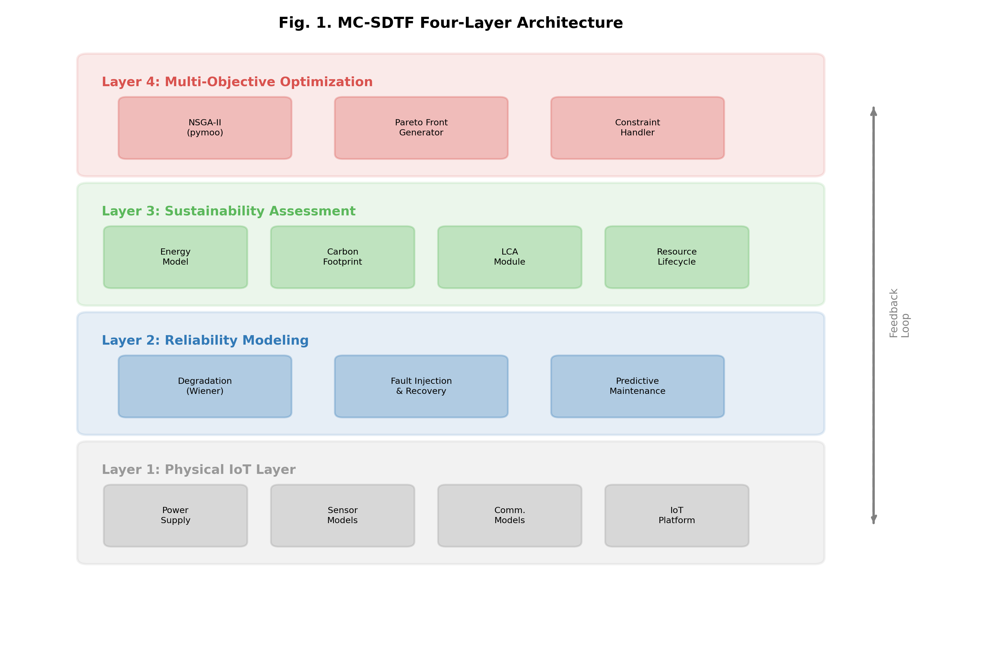
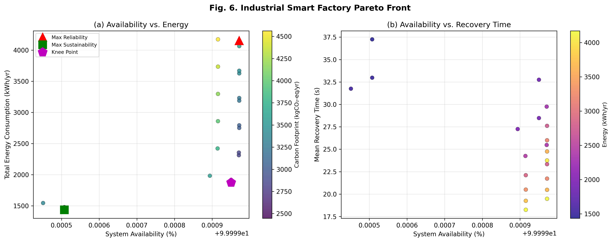

# MC-SDTF: Multi-Criteria Sustainable Digital Twin Framework for Mission-Critical IoT Systems

[](https://www.python.org/)
[](LICENSE)
[-orange.svg)](https://pymoo.org/)

> **Paper:** *A Digital Twin Framework for Multi-Objective Optimization of Reliability and Sustainability in Mission-Critical IoT Systems Using Python*

This repository contains the complete source code, data, and reproducibility instructions for the MC-SDTF framework, which jointly optimizes **mission-critical reliability** and **environmental sustainability** across multiple IoT domains using Pareto-based multi-objective optimization.

---

## Overview

MC-SDTF is a four-layer framework:

| Layer | Function | Implementation |
|-------|----------|----------------|
| **Layer 1** | Physical IoT (sensors, communication, power) | Mathematical models in `objectives.py` |
| **Layer 2** | Reliability (Wiener degradation, fault injection) | Stochastic models in `objectives.py` |
| **Layer 3** | Sustainability (energy, carbon LCA, lifecycle) | LCA models in `objectives.py` |
| **Layer 4** | Multi-Objective Optimization (NSGA-II) | pymoo optimizer in `optimizer.py` |



### Three Case Studies

| Domain | Nodes | Availability | Budget | Key Challenge |
|--------|-------|-------------|--------|---------------|
| **Industrial Smart Factory** | 500 sensors on 50 CNC machines | 99.99% | $500K | Bearing degradation coupling |
| **Smart City Monitoring** | 200 nodes over 2 km² | 99.9% / 99.99% | $200K | Solar harvesting integration |
| **Hospital Patient Monitoring** | 720 devices on 120 beds | 99.999% (ECG) | $800K | Five-nines ECG availability |

### Key Results

- **Industrial:** 54.9% energy reduction at knee point vs. maximum-reliability design
- **Smart City:** 71.1% energy reduction with solar harvesting
- **Healthcare:** 63.0% energy reduction despite 99.999% ECG constraint
- Gateway count is the universally dominant decision variable (r > 0.99)



---

## Quick Start

### 1. Clone the repository

```bash
git clone https://github.com/YOUR_USERNAME/MC-SDTF.git
cd MC-SDTF
```

### 2. Install dependencies

```bash
pip install -r requirements.txt
```

### 3. Run the framework

```bash
# Quick test (~2-5 minutes)
cd src
python main.py --quick

# Standard run (~15-30 minutes)
python main.py

# Full paper-quality run (~1-3 hours)
python main.py --full
```

### 4. View results

All outputs are saved to the `output/` directory:
- Pareto front figures (PNG + PDF)
- Numerical result tables (printed to console)
- Optimization data (`.pkl` files for further analysis)

---

## Repository Structure

```
MC-SDTF/
├── README.md                  # This file
├── LICENSE                    # MIT License
├── requirements.txt           # Python dependencies
├── .gitignore                 # Git ignore rules
│
├── src/                       # Source code
│   ├── main.py                # Master runner (entry point)
│   ├── config.py              # Case study parameters (Tables II-IV)
│   ├── objectives.py          # Objective & constraint functions
│   ├── optimizer.py           # NSGA-II optimizer (pymoo)
│   ├── visualizations.py      # Figure generation (Figs. 6-10)
│   ├── analysis.py            # Discussion analysis (Sections VI-VII)
│   ├── P01_architecture.py    # Fig. 1 architecture diagram
│   └── P02_sensor_node.py     # Fig. 2 sensor node diagram
│
├── results/                   # Sample outputs
│   └── figures/               # Pre-generated figures
│       ├── Fig1_Architecture.png
│       ├── Fig2_SensorNode.png
│       ├── Fig6_industrial_Pareto.png
│       ├── Fig7_smartcity_Pareto.png
│       ├── Fig8_healthcare_Pareto.png
│       ├── Fig9_CrossDomain.png
│       ├── Fig10_Convergence.png
│       └── Fig_SensitivityAnalysis.png
│
└── docs/                      # Documentation
    ├── equations.md            # Complete mathematical formulation
    └── execution_guide.md      # Detailed execution instructions
```

---

## Mathematical Formulation

### Decision Variables

| Symbol | Description | Range | Type |
|--------|-------------|-------|------|
| r | Redundancy level (simplex/dual/TMR) | {1, 2, 3} | Integer |
| d | Duty cycle | [0.01, 1.0] | Continuous |
| p_tx | Transmission power (dBm) | [0, 20] | Continuous |
| f_s | Sampling frequency (Hz) | [0.1, 100] | Continuous |
| α | Edge processing allocation | [0, 1] | Continuous |
| N_gw | Number of gateways | [3, 25] | Integer |
| T_m | Maintenance interval (hours) | [168, 4380] | Continuous |
| ε_h | Energy harvesting config | {0, 1, 2, 3} | Integer |

### Objectives (all minimized)

1. **f₁(x) = −A_sys(x)** — Negative system availability (maximize availability)
2. **f₂(x) = E_total(x)** — Total energy consumption (kWh/year)
3. **f₃(x) = CF_total(x)** — Carbon footprint (kgCO₂-eq/year)
4. **f₄(x) = MRT(x)** — Mean recovery time (seconds)

### Constraints

1. **g₁:** Availability ≥ A_min (domain-specific)
2. **g₂:** End-to-end latency ≤ L_max
3. **g₃:** Total deployment cost ≤ Budget

See [`docs/equations.md`](docs/equations.md) for the complete mathematical formulation (34 equations).

---

## Usage Examples

### Run a single case study

```python
from optimizer import run_optimization

# Run industrial optimization
result = run_optimization("industrial", pop_size=200, n_gen=500)

print(f"Pareto solutions: {result['n_pareto']}")
print(f"Time: {result['time']:.1f} seconds")
```

### Custom parameters

```python
from config import get_industrial_params

params = get_industrial_params()
params.A_min = 0.999        # Relax availability to 99.9%
params.budget = 300000      # Reduce budget to $300K
```

### Generate figures only (from existing results)

```bash
python main.py --figures-only
```

### Command-line options

| Flag | Pop Size | Generations | Approx. Time |
|------|----------|-------------|-------------|
| `--quick` | 50 | 50 | 2-5 min |
| *(default)* | 200 | 300 | 15-30 min |
| `--full` | 200 | 500 | 1-3 hours |
| `--pop N` | N | — | custom |
| `--gen N` | — | N | custom |

---

## Reproducing Paper Results

To reproduce the exact results reported in the paper:

```bash
cd src
python main.py --full
```

This will:
1. Print simulation environment specification (Section V.A)
2. Generate architecture and sensor node diagrams (Figs. 1-2)
3. Run NSGA-II optimization for all three case studies (Figs. 6-10, Tables V-VIII)
4. Print numerical results, sensitivity analysis, and key findings
5. Compute computational overhead and payback analysis (Section VI.C)
6. Print conclusion numerical highlights (Section VII)

All figures are saved as both PNG (300 dpi) and PDF (vector) in the `output/` directory.

---

## Dependencies

| Package | Version | Purpose |
|---------|---------|---------|
| numpy | ≥ 1.24 | Array operations |
| scipy | ≥ 1.11 | Scientific computing |
| matplotlib | ≥ 3.7 | Visualization |
| pymoo | ≥ 0.6 | NSGA-II multi-objective optimization |
| psutil | ≥ 5.9 | System information |

Tested on Python 3.9, 3.10, 3.11, and 3.12.

---

## Citation

If you use this framework in your research, please cite:

```bibtex
@article{mcsdtf2025,
  title={A Digital Twin Framework for Multi-Objective Optimization of
         Reliability and Sustainability in Mission-Critical IoT Systems
         Using Python},
  author={[Authors]},
  journal={IEEE Internet of Things Journal},
  year={2025},
  note={Under review}
}
```

---

## License

This project is licensed under the MIT License — see the [LICENSE](LICENSE) file for details.
